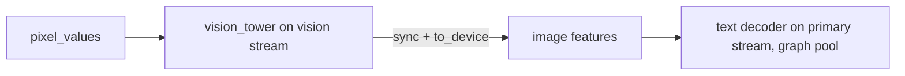

# Multi-Modal CUDA Graph Safety & Gemma4 Text-Only Serving

## Status: Partially Implemented (WP1-WP2 done, WP3-WP5 open)
**Target Milestone:** Serve `gemma-4-31B-it` text-only on CUDA with graphs on, with a clean path to image support later  
**Related Documents:**
* [`MEDUSA_SPEC.md`](MEDUSA_SPEC.md) - Speculative decoding; shares the CUDA-graph decode gate described here
* `mistralrs-core/src/pipeline/cuda_graph.rs` - Graph capture/replay implementation (read-only reference)

> [!IMPORTANT]
> **Instructions for a local LLM picking this up.** Do only what a Work Package (Section 5) says. Every symbol, path and
> command in Sections 2-3 was verified against the tree on 2026-10-11. Anything listed under "Does NOT exist" must be
> created by you, not assumed. Run the WP's acceptance command before moving to the next WP. If a fact here
> contradicts the code, trust the code and fix this doc.

---

## 1. Executive Summary & Problem Context

Upstream issue #2438: CUDA graph decode panicked / polluted the graph memory pool when vision requests ran through
`MultimodalPipeline`. Two causes:

1. **Gate gap.** `pixel_values.is_none()` is true during decode of an image request, so a multimodal batch could be
   replayed through a statically captured graph.
2. **Pool pollution.** `prepare_cuda_graph_memory_pool` (`pipeline/cuda_graph.rs:2662`) retains allocations; vision encoder
   buffers allocated on the same CUDA stream get trapped in that pool.

### 1.1 The Core Objective (current scope)
* **Now:** serve Gemma4 31B for **text only**, CUDA graphs on, no vision-related errors or warnings.
* **Later:** finish image support (WP5) without redesign.

### 1.2 Model naming
The checkpoint on disk is `/home/apex/sandbox/odyssey/hugdis/models/google/gemma-4-31B-it` (31B, not 27B).
`architectures = ["Gemma4ForConditionalGeneration"]`, `vision_config` present, `audio_config = null`.

---

## 2. Ground Truth (verified in tree)

| Fact | Where |
|---|---|
| Gemma4 is already routed to the multimodal pipeline | `pipeline/loaders/multimodal_loaders.rs` `Gemma4Loader` (~L8050), registry entry `name: "gemma4"` (~L9982) |
| Vision tower is loaded whenever `vision_config` is `Some` | `vision_models/gemma4/mod.rs` `Gemma4Model::new` (L223-278) |
| Text-only requests never call the vision tower; image requests without a tower bail with "Gemma4 model was loaded without a vision encoder." | `vision_models/gemma4/mod.rs` L367, L679 |
| Gemma4 text model supports CUDA decode graphs | `vision_models/gemma4/text.rs:1892`, `vision_models/gemma4/mod.rs:1014` |
| CUDA graphs are ON by default; disable with `MISTRALRS_CUDA_GRAPHS=0` | `docs/src/content/docs/reference/environment-variables.md:69` |
| `Sequence` keeps media hashes after prefill; raw images are taken out | `sequence.rs` `image_hashes`/`audio_hashes`/`video_hashes` (~L1965/2005/2052) vs `has_images()` (~L1977) |
| `Device::new_cuda_with_stream(ordinal: usize)` takes ONLY an ordinal | `candle/candle-core/src/device.rs:254` |

### 2.1 Does NOT exist (do not assume)
* A `--cuda-graph` CLI flag (graphs are env-controlled, see above).
* A text-only / skip-vision load option for Gemma4 (the tower always loads when `vision_config` exists).
* `Device::new_cuda_with_stream(ordinal, stream_id)` (two-arg form).
* A dedicated vision stream anywhere in `vision_models/`.

---

## 3. Implemented Changes (WP1-WP2, compiled with `cargo check -p mistralrs-core`, non-CUDA only)

| Change | File |
|---|---|
| `pub has_multimodal_data: bool` added to `ModelInputs` | `mistralrs-core/src/vision_models/mod.rs` |
| `pub(crate) fn has_multimodal_data(input_seqs, seq_indices)` - true if any selected seq has non-empty image/audio/video **hashes** (not `has_images()`, which is false after prefill) | same file |
| Every vision `InputsProcessor` sets the field; text-only fallthroughs in phi3/phi4/llava/llava_next and speculative-verify inputs set `false` | `vision_models/*/inputs_processor.rs`, `pipeline/multimodal.rs` |
| Graph gate extracted to `can_replay_cuda_decode_graph(has_lora, return_raw_logits, has_pixel_values, has_multimodal_data)`; `tracing::info!("Bypassing CUDA graph replay: Multimodal sequence detected")` when the flag is set | `pipeline/multimodal.rs` `forward_step` |
| Unit test `cuda_graph_gate_tests::multimodal_batches_skip_graph_replay` (`cfg(all(test, feature = "cuda"))`) | `pipeline/multimodal.rs` (end of file) |

**Effect on text-only Gemma4:** none. `has_multimodal_data` is `false`, so graph replay is unchanged.
**Effect on image requests:** the sequence stays on the eager path for its whole life (intended).

> [!WARNING]
> Not yet verified: the `--features cuda` build, the new test, and any run of Gemma4. Do WP3 first.

---

## 4. Design for Remaining Work

### 4.1 Text-only Gemma4 (WP4)
Goal: skip loading `vision_tower`/`embed_vision` (and audio) when the operator asks for text only, saving VRAM and
removing any vision code path.

Proposed shape (decision needed from the user, see Section 7):
```rust
// Gemma4Model::new: treat vision/audio configs as absent when text-only is requested
let vision_cfg = if text_only { None } else { cfg.vision_config.as_ref() };
```
The flag must be threaded from the CLI/builder to `Gemma4Loader::load`
(`multimodal_loaders.rs`, `impl MultimodalModelLoader for Gemma4Loader`, ~L8113) without touching other loaders.
Weight loading must still pass `model.safetensors.index.json` validation (see AGENTS.md "Models"); skipped prefixes
(`model.vision_tower`, `model.embed_vision`) must simply not be requested from the VarBuilder.

### 4.2 Vision stream isolation (WP5)
The original idea (separate stream for the vision tower) needs the candle API fixed first:
`Device::new_cuda_with_stream(ordinal)` creates a new stream per call, so the vision device is
`Device::new_cuda_with_stream(ordinal)?` with no stream id. Cross-stream sync is required: features are produced on
the vision stream and consumed on the text stream, so wait on an event (or `.to_device(&primary)`, verify it syncs)
before use. Prove the pool problem exists first (WP5 step 1) before changing model code.



---

## 5. Work Packages

Each WP: files, steps, acceptance. Do them in order.

### WP1 [DONE] `has_multimodal_data` plumbing
### WP2 [DONE] graph gate + trace log + test

### WP3 Verify under CUDA
* Files: none to edit unless fixes are needed.
* Steps: run the commands below; fix only compile/test failures caused by WP1-WP2.
* Acceptance:
```bash
cargo check -p mistralrs-core --features cuda
cargo test  -p mistralrs-core --features cuda cuda_graph_gate_tests
cargo clippy -p mistralrs-core --features cuda -- -D warnings
```

### WP4 Text-only Gemma4 (blocked on Section 7 decision)
* Files: `vision_models/gemma4/mod.rs` (`Gemma4Model::new`), `pipeline/loaders/multimodal_loaders.rs` (`Gemma4Loader`),
  CLI/builder arg plumbing (find with `grep -rn "max_model_len" mistralrs-cli/src mistralrs/src`).
* Steps: add the flag, skip vision/audio construction, make `Gemma4Loader` size estimators ignore vision/audio bytes
  when the flag is set (see test `gemma4_estimator_keeps_multimodal_weights_dense_for_isq`), add a unit test mirroring it.
* Acceptance: `cargo test -p mistralrs-core gemma4` passes; serving log shows no `vision_tower` tensors loaded.

### WP5 Vision stream isolation (do only when images are needed)
1. Reproduce: serve an image request with graphs on, record `nvidia-smi` memory before/after 20 image requests.
2. If memory grows, implement Section 4.2 behind the same gate; if not, close this WP and update this doc.
* Acceptance: memory delta across 20 requests is flat (+/- 100 MB) and output describes the image.

---

## 6. Verification Plan

### 6.1 Smoke test (text only, current scope)
```bash
cargo build --release --package mistralrs-cli --features "cuda flash-attn"
./target/release/mistralrs serve -p 1234 -m /home/apex/sandbox/odyssey/hugdis/models/google/gemma-4-31B-it
curl localhost:1234/v1/chat/completions -H 'Content-Type: application/json' \
  -d '{"model":"default","messages":[{"role":"user","content":"Say hi"}],"max_tokens":16}'
```
Pass: coherent reply, no panic, no "vision" warning, graph dispatch logs show replay.
Compare with `MISTRALRS_CUDA_GRAPHS=0` for output equivalence.

### 6.2 Image smoke test (WP5 era)
Send a base64 image in a chat request. Pass: log shows `Bypassing CUDA graph replay: Multimodal sequence detected`,
reply describes the image, no panic. Garbage output means feature buffers were overwritten (pool/stream bug).

---

## 7. Open Questions (ask the user, do not guess)
1. What exact message does mistral.rs print when serving Gemma4 today? (Not reproduced yet; WP4 may be the wrong fix.)
2. Text-only switch shape: CLI flag, config field, or auto-detect from absence of `vision_config`?
