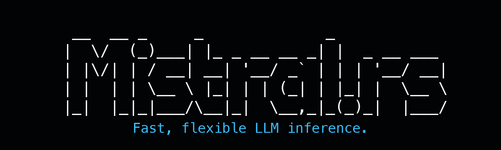

<a name="top"></a>
<!--
<h1 align="center">
  mistral.rs
</h1>
-->

<div align="center">
  <picture>
    <source media="(prefers-color-scheme: dark)" srcset="res/banner-dark.gif">
    <source media="(prefers-color-scheme: light)" srcset="res/banner-light.gif">
    
  </picture>
</div>

<p align="center">
  | <a href="https://docs.mistralrs.dev/"><b>Documentation</b></a> | <a href="https://docs.mistralrs.dev/quickstart/"><b>Quickstart</b></a> | <a href="https://docs.mistralrs.dev/reference/supported-models/"><b>Supported models</b></a> | <a href="https://crates.io/crates/mistralrs"><b>Rust SDK</b></a> | <a href="https://docs.mistralrs.dev/guides/python/getting-started/"><b>Python SDK</b></a> | <a href="https://discord.gg/SZrecqK8qw"><b>Discord</b></a> |
</p>

<p align="center">
  <a href="https://github.com/EricLBuehler/mistral.rs/stargazers">
    
  </a>
</p>

## Latest

- **LFM3 and LFM3-VL**: native support for `LiquidAI/LFM3-1.7B` and `LiquidAI/LFM3-VL-2B`, including text, image, and video inference, ISQ, paged attention, and chunked prefill. [Model notes](https://docs.mistralrs.dev/guides/models/model-family-notes/#lfm3-and-lfm3-vl)
- **v0.9.5**: paged attention is now the default on supported Metal models, with automatic memory planning across the CLI and SDKs. Existing memory and device-mapping options have changed; see the [upgrade guide](https://docs.mistralrs.dev/guides/perf/paged-attention/#upgrading-from-094). This release also adds [Qwen3.8-Flash-Next](https://docs.mistralrs.dev/guides/models/model-family-notes/#qwen38-flash-next) and [CUDA 13.4 source builds](https://docs.mistralrs.dev/developer/from-source/).
- **Muse Glimmer 30B**: native text, image, and video inference with ATEM tool calling, reasoning controls, LoRA, ISQ/UQFF, and companion-projector GGUF loading. [Model notes](https://docs.mistralrs.dev/guides/models/model-family-notes/#muse-glimmer)
- **GGUF loading**: load a local file with `-f`, or select a published artifact with `--quant`. Tokenizer, configuration, and multimodal projector files are discovered when the available metadata identifies them unambiguously. [Guide](https://docs.mistralrs.dev/guides/models/run-gguf/)
- **OpenAI-compatible Skills**: upload `/v1/skills` bundles and reference them from Responses requests for reusable procedures, helper scripts, and local data. [Guide](https://docs.mistralrs.dev/guides/agents/skills/)
- **OpenAI-compatible file inputs**: upload `/v1/files`, attach Responses `input_file` or Chat `file` parts, and mount request files into shell/code sessions. [Guide](https://docs.mistralrs.dev/guides/agents/file-inputs/)
- **DiffusionGemma**: block-diffusion text generation. Fully integrated: paged attention, prefix caching, ISQ, multimodal, and tool calling. [Guide](https://docs.mistralrs.dev/guides/models/use-block-diffusion/)
- **Anthropic Messages API**: `mistralrs serve` now exposes Anthropic-compatible `/v1/messages` and `/v1/messages/count_tokens` endpoints alongside the OpenAI-compatible `/v1` API. [Guide](https://docs.mistralrs.dev/guides/serve/anthropic-messages-api/)
- **v0.8.2 CUDA performance**: paged-attention and MoE optimizations deliver strong results on GB10, B200, and H100 SXM. [Benchmarks](#benchmarks)
- **Agentic runtime**: web search, local Python code execution, shell execution, OpenAI-compatible Skills, session management, and custom tool hooks. [Guide](https://docs.mistralrs.dev/guides/agents/)
- **Gemma 4**: full multimodal: text, image, video, and audio input. [Supported models](https://docs.mistralrs.dev/reference/supported-models/) | [Video setup](https://docs.mistralrs.dev/guides/models/video-setup/)

## Benchmarks

<details>
<summary><b>v0.8.2 CUDA benchmarks</b></summary>

Mean tokens per second across prompt lengths and decode depths from 128 to 16384 tokens. Decode uses 256 generated tokens. See the full [v0.8.2 report](releases/v0.8.2/report.md) for commands, model revisions, host metadata, and appendix tables.

**Q8 prefill TPS: mistral.rs UQFF q8 vs llama.cpp GGUF Q8_0**

| Model | Hardware | mistral.rs | llama.cpp |
|---|---|---:|---:|
| Gemma 4 E4B | GB10 | 7395.7 | 3973.7 |
| Gemma 4 E4B | B200 | 27705.6 | 11992.4 |
| Gemma 4 E4B | H100 SXM | 26220.6 | 11702.1 |
| Gemma 4 26B-A4B | GB10 | 2947.0 | 2178.5 |
| Gemma 4 26B-A4B | B200 | 12725.3 | 8503.4 |
| Gemma 4 26B-A4B | H100 SXM | 12362.3 | 8055.1 |

**Q8 decode TPS: mistral.rs UQFF q8 vs llama.cpp GGUF Q8_0**

| Model | Hardware | mistral.rs | llama.cpp |
|---|---|---:|---:|
| Gemma 4 E4B | GB10 | 44.1 | 40.5 |
| Gemma 4 E4B | B200 | 241.4 | 194.4 |
| Gemma 4 E4B | H100 SXM | 223.1 | 183.0 |
| Gemma 4 26B-A4B | GB10 | 46.8 | 46.4 |
| Gemma 4 26B-A4B | B200 | 210.9 | 192.2 |
| Gemma 4 26B-A4B | H100 SXM | 199.8 | 183.9 |

**BF16 prefill TPS: mistral.rs BF16 vs vLLM BF16**

| Model | Hardware | mistral.rs | vLLM |
|---|---|---:|---:|
| Gemma 4 E4B | GB10 | 5838.9 | 5812.9 |
| Gemma 4 E4B | B200 | 43547.8 | 39431.2 |
| Gemma 4 E4B | H100 SXM | 35852.2 | 39293.7 |
| Gemma 4 26B-A4B | GB10 | 592.2 | 3878.6 |
| Gemma 4 26B-A4B | B200 | 3467.3 | 28532.8 |
| Gemma 4 26B-A4B | H100 SXM | 2766.0 | 26295.9 |

**BF16 decode TPS: mistral.rs BF16 vs vLLM BF16**

| Model | Hardware | mistral.rs | vLLM |
|---|---|---:|---:|
| Gemma 4 E4B | GB10 | 25.1 | 18.8 |
| Gemma 4 E4B | B200 | 202.6 | 196.2 |
| Gemma 4 E4B | H100 SXM | 174.4 | 153.0 |
| Gemma 4 26B-A4B | GB10 | 26.9 | 23.2 |
| Gemma 4 26B-A4B | B200 | 159.6 | 220.2 |
| Gemma 4 26B-A4B | H100 SXM | 138.7 | 148.0 |

</details>

## Why mistral.rs?

- **Automatic model loading**: Architecture, weight format, and chat template are detected for supported Hugging Face models and GGUF files, with flags available for explicit selection.
- **True multimodality**: Text, vision, video, and audio, speech generation, image generation, and embeddings in one engine.
- **Quantization selection**: `--quant` selects a matching artifact from GGUF repositories. For other Hugging Face repositories, it uses a prebuilt UQFF when available and otherwise applies ISQ. [Docs](https://docs.mistralrs.dev/guides/quantization/quantize-a-model/)
- **OpenAI + Anthropic compatible serving**: The same `mistralrs serve` process exposes OpenAI-compatible `/v1` endpoints and Anthropic-compatible Messages endpoints.
- **Prometheus metrics**: `mistralrs serve` exposes a `/metrics` endpoint in Prometheus format, recording per-request counts and latency labeled by method, route, and status. [Docs](https://docs.mistralrs.dev/reference/http-api/)
- **Built-in web UI**: Served at `/ui` by default. Shows reasoning, code execution, plots, and files inline. Edit any message and the new branch runs with its own Python state. Pass `--no-ui` to disable.
- **Hardware-aware**: `mistralrs tune` recommends quantization and device mapping from the model config and your detected hardware.
- **Flexible SDKs**: Python package and Rust crate to build your projects.
- **Native agentic support**: built-in [agentic loop](https://docs.mistralrs.dev/guides/agents/) with web search, local Python code execution, shell execution, OpenAI-compatible Skills, session management, and custom tool hooks.

## Quick Start

### Install

Run the command for your platform in a terminal, then follow the installer.

**macOS / Linux:**

```bash
curl -fsSL https://mistralrs.dev/install.sh | sh
```

**Windows (PowerShell):**

```powershell
irm https://mistralrs.dev/install.ps1 | iex
```

When installation finishes, open a new terminal.

### Chat in Your Browser

Start a model:

```bash
mistralrs serve -m Qwen/Qwen3-4B --quant 4
```

When the server is ready, open [http://localhost:1234/ui](http://localhost:1234/ui) and send a message. Keep the terminal open while chatting; press Ctrl+C to stop.

[Quickstart](https://docs.mistralrs.dev/quickstart/) | [Installer options](https://docs.mistralrs.dev/reference/installer/)

<details open>
  <summary><b>UI Demo</b></summary>
  <br>
  
</details>

## What Makes It Fast

**Performance**
- Continuous batching support by default on all devices.
- CUDA with FlashAttention V2/V3, Metal, and [multi-GPU/distributed inference](https://docs.mistralrs.dev/guides/perf/distributed-inference/)
- [PagedAttention](https://docs.mistralrs.dev/guides/perf/paged-attention/) for high throughput continuous batching on CUDA or Apple Silicon, prefix caching (including multimodal)

**Quantization** ([full docs](https://docs.mistralrs.dev/reference/quantization-types/))
- [In-situ quantization (ISQ)](https://docs.mistralrs.dev/guides/quantization/quantize-a-model/) for Hugging Face models
- [GGUF](https://docs.mistralrs.dev/reference/gguf-support/) (2-8 bit), GPTQ, AWQ, HQQ, FP8, BNB support
- ⭐ [Per-layer topology](https://docs.mistralrs.dev/guides/perf/topology/): Fine-tune quantization per layer for optimal quality/speed
- ⭐ Auto-select fastest quant method for your hardware

**Flexibility**
- [LoRA & X-LoRA](https://docs.mistralrs.dev/guides/customize/lora-adapters/) with per-request LoRA selection and X-LoRA adapter mixing
- AnyMoE: Create mixture-of-experts on any base model
- [Multiple models](https://docs.mistralrs.dev/guides/serve/multiple-models/): Load/unload at runtime

**Agentic Features**
- Integrated [tool calling](https://docs.mistralrs.dev/guides/agents/tool-calling-basics/) with grammar enforcement and strict schema mode
- ⭐ Server-side [agentic loop](https://docs.mistralrs.dev/guides/agents/tool-calling-basics/): auto-execute tools and feed results back
- ⭐ [Python code execution](https://docs.mistralrs.dev/guides/agents/enable-code-execution/): persistent Jupyter-like sessions with matplotlib capture and multimodal feedback
- ⭐ [Shell execution](https://docs.mistralrs.dev/guides/agents/enable-shell/): persistent command-line sessions with sandboxing and approval controls
- ⭐ [OpenAI-compatible Skills](https://docs.mistralrs.dev/guides/agents/skills/): uploaded skill bundles for Responses API agents
- ⭐ [OpenAI-compatible file inputs](https://docs.mistralrs.dev/guides/agents/file-inputs/): `/v1/files`, Responses `input_file`, Chat `file`, and workdir mounts
- ⭐ [Web search integration](https://docs.mistralrs.dev/guides/agents/web-search/) with embedding-based ranking
- ⭐ [Tool dispatch URL](https://docs.mistralrs.dev/guides/agents/tool-calling-basics/): POST tool calls to your own endpoint
- ⭐ [MCP client](https://docs.mistralrs.dev/guides/agents/connect-mcp-server/): Connect to external tools via Process, HTTP, or WebSocket
- Python/Rust [tool callbacks](https://docs.mistralrs.dev/guides/agents/tool-calling-basics/) for custom execution

[Full feature documentation](https://docs.mistralrs.dev/)

## Supported Models

Text, multimodal, speech, image generation, and embedding models across 45+ architectures. The **[supported models reference](https://docs.mistralrs.dev/reference/supported-models/)** is the single source of truth: it explains how to check whether your model's `config.json` is supported, lists every architecture with copy-paste run commands, and is generated directly from the engine's loader registry so it never drifts.

[Supported models reference](https://docs.mistralrs.dev/reference/supported-models/) | [Request a new model](https://github.com/EricLBuehler/mistral.rs/issues/156)

## Python SDK

```bash
pip install mistralrs
```

In-process inference from Python: load a model with `Runner` and send OpenAI-shaped requests, no server required. Accelerator-specific wheels (CUDA, Metal, MKL, Accelerate) are listed in the getting-started guide.

[Get started](https://docs.mistralrs.dev/guides/python/getting-started/) | [API reference](https://docs.mistralrs.dev/reference/python/) | [Examples](examples/python)

## Rust SDK

```bash
cargo add mistralrs
```

Embed the engine in a Rust application with the high-level `mistralrs` crate.

[Get started](https://docs.mistralrs.dev/guides/rust/getting-started/) | [docs.rs](https://docs.rs/mistralrs) | [Crate](https://crates.io/crates/mistralrs) | [Examples](mistralrs/examples)

## Docker

Prebuilt CPU and CUDA images are published to GHCR. Pull commands, tags, and Kubernetes notes are in the [Docker guide](https://docs.mistralrs.dev/guides/deploy/docker/).

## Documentation

For complete documentation, see the **[Documentation](https://docs.mistralrs.dev/)**.

**Quick Links:**
- [Quickstart](https://docs.mistralrs.dev/quickstart/) - Install, first run, first serve
- [CLI Reference](https://docs.mistralrs.dev/reference/cli/) - All commands and options
- [Anthropic Messages API](https://docs.mistralrs.dev/guides/serve/anthropic-messages-api/) - Anthropic-compatible Messages, streaming, tool use, and token counting
- [HTTP API](https://docs.mistralrs.dev/reference/http-api/) - OpenAI-compatible and Anthropic-compatible endpoints
- [Quantization](https://docs.mistralrs.dev/reference/quantization-types/) - ISQ, GGUF, GPTQ, and more
- [Multi-GPU and Distributed](https://docs.mistralrs.dev/guides/perf/distributed-inference/) - NCCL TP, P2P layer mapping, multi-node, and ring
- [MCP Integration](https://docs.mistralrs.dev/guides/agents/connect-mcp-server/) - MCP integration documentation
- [Troubleshooting](https://docs.mistralrs.dev/reference/troubleshooting/) - Common issues and solutions
- [Environment variables](https://docs.mistralrs.dev/reference/environment-variables/) - Environment variables for configuration

## Citation

If you use mistral.rs in your research, please cite:

```bibtex
@misc{mistralrs,
  author = {Buehler, Eric},
  title = {{mistral.rs}: Fast, flexible {LLM} inference},
  year = {2024},
  url = {https://github.com/EricLBuehler/mistral.rs}
}
```

Citation metadata is available in [CITATION.cff](CITATION.cff).

## Contributing

Contributions welcome! Please [open an issue](https://github.com/EricLBuehler/mistral.rs/issues) to discuss new features or report bugs. If you want to add a new model, please contact us via an issue and we can coordinate.

## Credits

This project would not be possible without the excellent work at [Candle](https://github.com/huggingface/candle). Thank you to all [contributors](https://github.com/EricLBuehler/mistral.rs/graphs/contributors)!

mistral.rs is not affiliated with Mistral AI.

<p align="right">
  <a href="#top">Back to Top</a>
</p>
