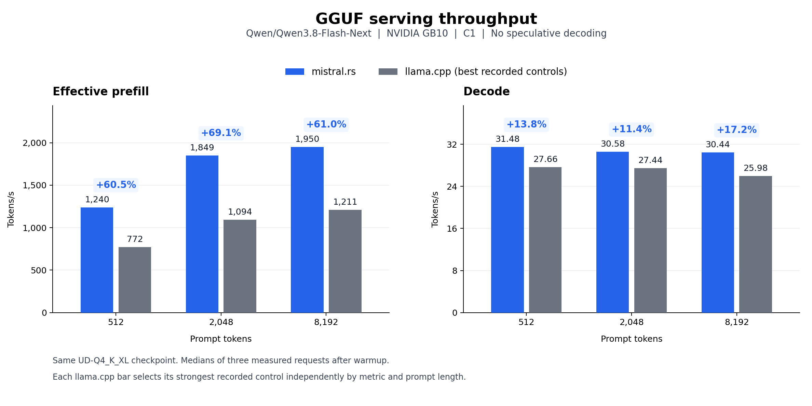
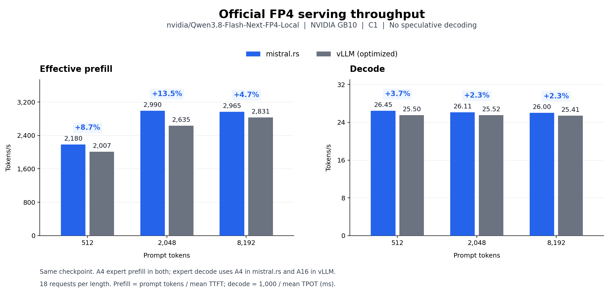
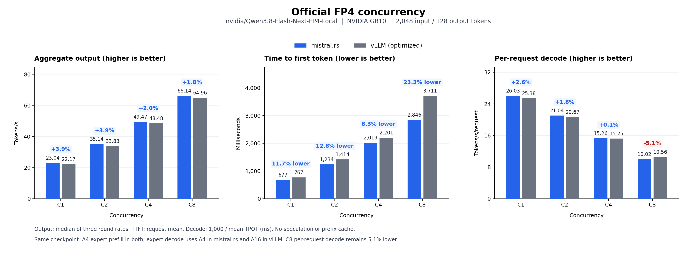

# mistral.rs v0.9.5: faster Qwen3.8-Flash-Next on GB10

Qwen3.8-Flash-Next brings a demanding mix of routed experts, hyper-connections, attention, and per-layer embeddings. We optimized those paths in mistral.rs and measured warmed text generation on one NVIDIA GB10, including a new concurrency sweep from C1 through C8.

With the same GGUF weights, mistral.rs delivers **60.5-69.1% higher effective prefill rates and 11.4-17.2% higher decode rates than the tested llama.cpp controls**. With the official FP4 checkpoint, it delivers **4.7-13.5% higher effective prefill rates and 2.3-3.7% higher decode rates than the tested optimized vLLM configuration**.

Those earlier C1 comparisons use 512, 2,048, and 8,192 prompt tokens. The latest official FP4 sweep uses 2,048 prompt tokens and leads the saved optimized vLLM result by **1.8-3.9% in aggregate output throughput at C1, C2, C4, and C8**, with **8.3-23.3% lower TTFT**. Every performance request generates 128 tokens without speculative decoding.

## GGUF: a lead in both phases

Both engines load the same four `UD-Q4_K_XL` GGUF shards. Each llama.cpp bar is its strongest recorded median for that metric and prompt length across four controls, including both 512- and 8,192-token chunk settings. This gives the comparator the benefit of its best recorded setting in every cell.

| Prompt tokens | mistral.rs prefill | llama.cpp prefill | Gain | mistral.rs decode | llama.cpp decode | Gain |
|---:|---:|---:|---:|---:|---:|---:|
| 512 | 1,239.52 | 772.23 | +60.5% | 31.48 | 27.66 | +13.8% |
| 2,048 | 1,849.43 | 1,093.76 | +69.1% | 30.58 | 27.44 | +11.4% |
| 8,192 | 1,949.88 | 1,211.21 | +61.0% | 30.44 | 25.98 | +17.2% |

Rates are tokens/s. Results use medians of three measured requests after warmup. Both engines use BF16 KV caches; mistral.rs uses BF16 activations and casts F32 dense weights to BF16, while llama.cpp retains F32 dense storage. Generated tokens and expert routing can differ. Native `--quant 4` is a different quantization and is not used for this comparison.

## Official FP4: earlier C1 prompt-length results

Both engines load the same official `nvidia/Qwen3.8-Flash-Next-FP4-Local` revision and keep its original BF16 output head. The vLLM comparator is a pinned GB10-optimized B12X image with resident device PLE, not a generic default configuration.

The activation policies differ: both use A4 expert prefill, while mistral.rs follows the checkpoint's A4 expert decode recipe and vLLM uses A16 expert decode. This is a comparison of the same checkpoint weights with those policies, not equal activation precision.

| Prompt tokens | mistral.rs TTFT (ms) | vLLM TTFT (ms) | Prefill rate gain | mistral.rs decode (tok/s) | vLLM decode (tok/s) | Decode gain |
|---:|---:|---:|---:|---:|---:|---:|
| 512 | 234.83 | 255.16 | +8.7% | 26.45 | 25.50 | +3.7% |
| 2,048 | 684.93 | 777.11 | +13.5% | 26.11 | 25.52 | +2.3% |
| 8,192 | 2,763.16 | 2,893.87 | +4.7% | 26.00 | 25.41 | +2.3% |

Each length has 18 measured requests across three rounds. mistral.rs leads in both metrics in all three rounds at every tested length. All 54 measured outputs repeat the conditioning outputs within each engine; additional repeated requests produce identical text and logprobs. Four short reference answers also match across engines. These checks establish repeatability on the fixture, not broad quality equivalence.

## Official FP4: throughput and TTFT from C1 to C8

The latest sweep keeps the same official FP4 weights and activation policies, with a 2 GiB BF16 KV cache, a 16,384-token context limit, and 4,096-token batch and prefill-chunk limits. Both servers support up to eight sequences. Prefix caching and speculative decoding are disabled.

| Concurrency | mistral.rs output tok/s | vLLM output tok/s | Throughput gain | mistral.rs TTFT (ms) | vLLM TTFT (ms) |
|---:|---:|---:|---:|---:|---:|
| 1 | 23.04 | 22.17 | +3.9% | 677.45 | 767.35 |
| 2 | 35.14 | 33.83 | +3.9% | 1,233.91 | 1,414.31 |
| 4 | 49.47 | 48.48 | +2.0% | 2,018.57 | 2,201.14 |
| 8 | 66.14 | 64.96 | +1.8% | 2,846.46 | 3,711.10 |

C8 throughput improved **24.2%** over the starting mistral.rs concurrency baseline, while C1 stayed within 0.2%. The latest run leads vLLM in aggregate throughput and TTFT at all four points. C8 per-request decode remains **5.1% slower**: 10.02 versus 10.56 tokens/s/request, despite its 23.3% lower TTFT. Aggregate serving throughput and individual decode speed measure different parts of the request lifecycle.

Throughput is the median of three closed-loop rounds per concurrency. There are 144 measured requests per engine after a complete conditioning sweep and discarded warmup waves. All serial and concurrent reference checks pass; the final mistral.rs run retains all 16 decode graphs without capture failures or memory-pressure evictions. These are modest margins from one warmed protocol per engine, not confidence bounds over independent restarts. Batch composition can change generated outputs, so the earlier C1 exact-repeat checks do not establish repeatability for this sweep.

## Shared improvements

The work includes shared GGUF projection and expert kernels, mixed NVFP4/MXFP8 checkpoint loading, native packed FP4 decode, and cuTile prefill kernels. A shared hyper-connection layer fuses the up projection with gated residual mixing. File-mapped embedding storage avoids another full-table disk allocation, and kernel warmup now reports progress.

The concurrency work improves batched NVFP4 expert and MXFP8 execution and preserves correct handling of offset tensor views. Shared GDN decode reduces full state writes with a short update journal, keeping FP32 state and BF16 activations. Both sigmoid and SiLU variants share the lifecycle handling for prefill, batch changes, snapshots, and rollback.

These paths dispatch on quantization format, dimensions, routing, and hardware capabilities. The serving results measure their combined effect; they do not isolate each kernel's contribution.

## Measurement scope and figures

Effective prefill is prompt tokens divided by client-observed TTFT, so it includes scheduling and first-token work. Decode is the rate after the first token, excluding prompt processing. The earlier FP4 C1 sweep uses reciprocal mean latency across 18 requests per length; GGUF uses medians of three. The concurrency sweep reports median whole-round output throughput and mean request latencies, including the workload's ramp and drain. The three measurement sets have separately recorded source identities.

The package includes [aggregate results](results.json) and a plotting script that regenerates all three figures without running inference. Exact prompts, raw responses, logs, and historical source patches are not included.

Read the [full report](report.md) for methodology, environment measurements, source identities, and the figure-generation command. These results cover warmed text generation on this GB10: GGUF at C1 and official FP4 at C1-C8, measured October 27-29, 2026 UTC.
