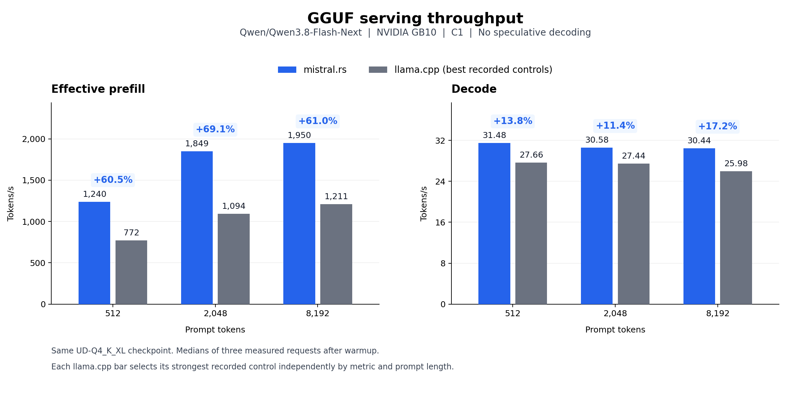
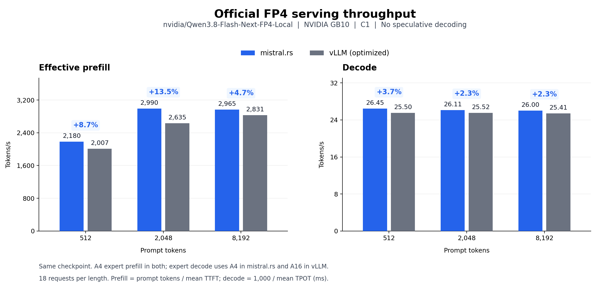
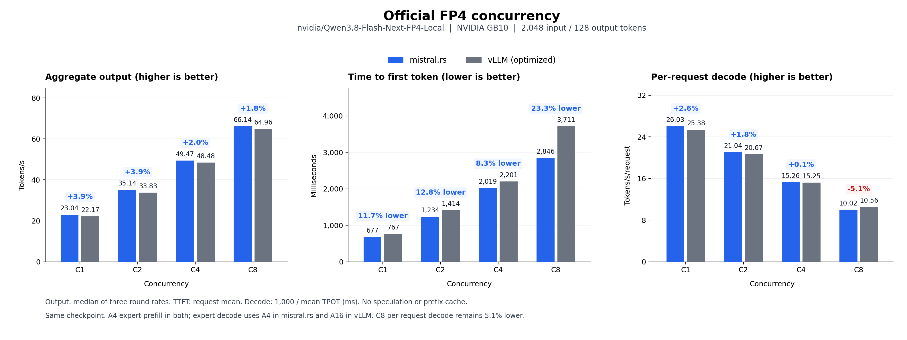

# mistral.rs v0.9.5: Qwen3.8-Flash-Next on NVIDIA GB10

With the official FP4 checkpoint, the latest mistral.rs sweep leads the tested optimized vLLM configuration by **1.8-3.9% in aggregate output throughput at C1, C2, C4, and C8**, with **8.3-23.3% lower time to first token**. C8 reaches **66.14 output tokens/s**, a **24.2% improvement** over the starting mistral.rs concurrency baseline. Per-request decode at C8 remains 5.1% slower than vLLM.

Earlier concurrency-one comparisons establish the prompt-length results: mistral.rs leads the tested llama.cpp controls by **60.5-69.1% in effective prefill and 11.4-17.2% in decode** with the same GGUF weights. With official FP4 weights, it leads optimized vLLM by **4.7-13.5% in effective prefill and 2.3-3.7% in decode**.

The measurements span October 27-29, 2026 UTC. The earlier C1 sweeps use 512, 2,048, and 8,192 prompt tokens; the new concurrency sweep uses 2,048 prompt tokens. All generate 128 tokens without speculative decoding. The GGUF, earlier FP4 C1, and latest FP4 concurrency results have separate source identities and protocols. Preparing this package did not rerun inference.

## Same GGUF weights: mistral.rs and llama.cpp



Both engines load the same four `UD-Q4_K_XL` shards from `unsloth/Qwen3.8-Flash-Next-GGUF`. All rates below are tokens/s, reported as the median of three requests after warmup.

| Prompt tokens | mistral.rs prefill | llama.cpp prefill | Gain | mistral.rs decode | llama.cpp decode | Gain |
|---:|---:|---:|---:|---:|---:|---:|
| 512 | 1,239.52 | 772.23 | +60.5% | 31.48 | 27.66 | +13.8% |
| 2,048 | 1,849.43 | 1,093.76 | +69.1% | 30.58 | 27.44 | +11.4% |
| 8,192 | 1,949.88 | 1,211.21 | +61.0% | 30.44 | 25.98 | +17.2% |

mistral.rs uses 8,192-token batches and prefill chunks. The llama.cpp comparator deliberately takes the **highest recorded median independently for each prompt length and metric** across four controls: historical and fresh runs with 512- and 8,192-token chunks. It is not one simultaneous configuration. The winning prefill controls are fresh 8,192 / historical 8,192 / fresh 8,192; the historical 512 control wins all three decode cells. The selected aggregate rates are included in [results.json](results.json).

Both use BF16 KV caches. mistral.rs selects BF16 activations and casts F32 dense weights to BF16; llama.cpp retains F32 dense storage. Generated tokens and expert routing can differ. Historical GGUF full-model determinism was not established, so this comparison measures fixed-prompt serving rather than identical-token, teacher-forced decode. Native `--quant 4` results use different weights and are excluded.

## Official FP4 weights: earlier C1 prompt-length sweep



Both load `nvidia/Qwen3.8-Flash-Next-FP4-Local` at revision `b9ce18a6887e18c089fdea8509a33e63429a3300`, preserving the original BF16 output head. The comparator is the pinned GB10-optimized `spark-vllm-b12x` image, with its B12X linear, expert, and GDN backends and resident device PLE table.

**Activation policies differ:** routed experts use A4 for prefill in both engines; decode uses A4 in mistral.rs and A16 in vLLM. mistral.rs follows the checkpoint's `NVFP4` activation recipe. These are the same checkpoint weights, not an activation-precision-matched experiment. For dense MXFP8, mistral.rs uses A16 for C1 decode and A8 for prefill; vLLM automatically selects between A16 and A8.

| Prompt tokens | mistral.rs TTFT (ms) | vLLM TTFT (ms) | Prefill rate gain | mistral.rs decode (tok/s) | vLLM decode (tok/s) | Decode gain |
|---:|---:|---:|---:|---:|---:|---:|
| 512 | 234.83 | 255.16 | +8.7% | 26.45 | 25.50 | +3.7% |
| 2,048 | 684.93 | 777.11 | +13.5% | 26.11 | 25.52 | +2.3% |
| 8,192 | 2,763.16 | 2,893.87 | +4.7% | 26.00 | 25.41 | +2.3% |

The table uses all 18 measured requests per length: three rounds of six. Prefill rate is prompt tokens divided by mean TTFT; decode rate is the reciprocal of mean TPOT. All three individual rounds favor mistral.rs for both metrics at every length. These are observations from one warmed protocol per engine, not confidence bounds over independent server restarts.

The earlier C1 FP4 correctness checks passed on both engines:

- Four short reference answers match between engines.
- Nine nonstreaming requests give six within-engine comparisons with identical text and logprobs.
- All 54 measured outputs exactly repeat the corresponding conditioning outputs within each engine.

These checks establish repeatability for the recorded workload. They do not establish general quality equivalence between activation policies or identical generated tokens across engines.

## Official FP4 weights: C1-C8 concurrency sweep



The latest sweep uses the same official checkpoint revision, original BF16 output head, and optimized vLLM software identified above. Both servers permit up to eight sequences, with a 16,384-token context limit, 4,096-token batch and prefill-chunk limits, and a 2 GiB BF16 KV cache. Prefix caching and speculative decoding are disabled. The A4 mistral.rs / A16 vLLM routed-decode precision difference also applies here; mistral.rs dense MXFP8 uses A8 for batched decode.

| Concurrency | mistral.rs output tok/s | vLLM output tok/s | Throughput gain | mistral.rs TTFT (ms) | vLLM TTFT (ms) | TTFT reduction |
|---:|---:|---:|---:|---:|---:|---:|
| 1 | 23.04 | 22.17 | +3.9% | 677.45 | 767.35 | 11.7% |
| 2 | 35.14 | 33.83 | +3.9% | 1,233.91 | 1,414.31 | 12.8% |
| 4 | 49.47 | 48.48 | +2.0% | 2,018.57 | 2,201.14 | 8.3% |
| 8 | 66.14 | 64.96 | +1.8% | 2,846.46 | 3,711.10 | 23.3% |

Aggregate output throughput includes prompt processing, scheduling, and the closed-loop workload's ramp and drain. It is the median of three whole-round output-token rates. Per-request decode measures the interval after the first token and tells a different part of the story:

| Concurrency | mistral.rs decode (tok/s/request) | vLLM decode (tok/s/request) | Decode gain | mistral.rs round range (output tok/s) |
|---:|---:|---:|---:|---:|
| 1 | 26.03 | 25.38 | +2.6% | 23.03-23.05 |
| 2 | 21.04 | 20.67 | +1.8% | 35.02-35.39 |
| 4 | 15.26 | 15.25 | +0.1% | 49.19-49.75 |
| 8 | 10.02 | 10.56 | -5.1% | 65.07-66.35 |

The aggregate throughput and TTFT advantages hold at every tested concurrency; per-request decode is effectively tied at C4 and still trails at C8. These modest throughput margins are measurements from one warmed sweep per engine, not confidence bounds over independent restarts.

Compared with the recorded starting mistral.rs concurrency baseline, output throughput improved by 8.9% at C2, 13.9% at C4, and 24.2% at C8; C1 stayed within 0.2%. The final run matches all four serial and eight concurrent reference answers from vLLM. All 159 conditioning requests and 159 measured-stage requests pass fixture, token-count, stream-order, HTTP, and completion checks. Of the latter, 144 requests contribute to the measured cells. Long-prompt output repeats vary with batch composition, so the earlier C1 repeatability result is not extended to this sweep.

The mistral.rs run retained all 16 captured decode graphs with zero capture failures or memory-pressure evictions. Its minimum sampled available memory was 38.75 GiB; system-wide swap counters recorded 28.07 MiB in and no swap out during measurement. These counters do not attribute activity to inference.

## What changed

The implementation optimizes shared operations and quantization backends rather than matching a model identifier:

- Shared GGUF vector-dot, indexed expert, compact prefill, paired-projection, and embedding paths cover their supported format families. Dispatch uses storage, runtime dimensions, routing, and hardware capabilities.
- Hyper-connections use a shared layer with configurable stream count, width, rank, and epsilon. cuTile fuses the prefill up projection with gated residual mixing, avoiding the expanded intermediate and separate mixing pass.
- Mixed ModelOpt loading preserves per-layer NVFP4, MXFP8, and unquantized recipes. Native packed FP4 decode, routed expert operations, MXFP8 matrix kernels, and quantized embedding gathers share these format implementations.
- Batched NVFP4 expert dispatch and MXFP8 matrix kernels use dimensions, routing, and GPU capacity to select shared execution paths. Offset tensor views retain their correct bounds through routing and quantized kernels.
- Shared GDN decode can defer full state writes while retaining FP32 recurrent state and BF16 activations. Both SiLU and sigmoid gates use the same implementation, with materialization at batch transitions, prefill, snapshots, and rollback. The change applies across supported GDN architecture consumers independently of weight quantization.
- PLE storage can remain file-mapped in host memory, with CPU prefill gathers and supported mapped GPU decode access. This avoids creating another full table on disk. Kernel warmup reports progress.

The tables measure the combined serving implementations, not the isolated contribution of each optimization. The GGUF and C1 prompt-length measurements precede the latest concurrency implementation; their source identities are recorded separately.

## Measurement protocol

| Setting | GGUF C1 comparison | Earlier FP4 C1 comparison |
|---|---|---|
| Hardware | One NVIDIA GB10, SM121, 24 MiB L2 | Same box |
| Host | aarch64, 128 GB unified memory (about 121.7 GiB OS-visible) | Same box |
| Driver | 580.126.09 | 580.126.09 |
| Concurrency / context limit | 1 / 16,384 | 1 / 16,384 |
| Output length | 128 tokens, EOS ignored | 128 tokens, EOS ignored |
| Sampling | Temperature 0 | Temperature 0, seed 20260904, thinking disabled |
| Prefix cache / speculation | Disabled / disabled | Disabled / disabled |
| KV cache | BF16, 16,384-token budget | BF16, 2 GiB budget |
| Batch / chunk | mistral.rs 8,192; llama.cpp 512 and 8,192 | Both 4,096 |
| Samples per length | Three measured requests | 18 measured requests |
| Aggregation | Median per run | Arithmetic mean latency, then conversion to rate |

GGUF runs use a full fixture sweep to warm the service, followed by one discarded warmup and three measured requests at each length. The historical llama.cpp 512 control followed an exploratory full sweep. llama.cpp receives token IDs; mistral.rs receives text with an exact tokenizer round-trip assertion and server token-count check. All recorded canonical streams have 128 nonempty chunks and 128 completion tokens.

The earlier FP4 C1 runs use this order: four reference requests, nine logprob requests, five independent warmups, 57 conditioning requests, then 57 measured-stage requests. Each 57-request sweep contains three discarded warmups plus 54 requests across the three lengths. Reference requests use a 48-token maximum and normal EOS; performance and repeat-logprob requests use 128 tokens and ignore EOS. Request order and prompt bytes were fixed between engines.

The concurrency protocol uses four serial and eight concurrent references, a complete 159-request conditioning sweep, and a separate 159-request measured-stage sweep. Each sweep discards one warmup wave per concurrency (15 requests total), then runs three rounds of `max(6, 3 * concurrency)` requests at C1, C2, C4, and C8. The measured totals are 18, 18, 36, and 72 requests respectively. Both engines used the same prompt bytes and request order, with temperature 0, seed 20260904, thinking disabled, and EOS ignored. vLLM's already recorded concurrency sweep is reused; it was not rerun for this update.

TTFT is measured by the client from request start to the first nonempty stream delta. FP4 includes content or reasoning deltas. GGUF decode ends at the last nonempty chunk; FP4 decode ends at the `finish_reason` SSE event. In both cases, TPOT divides the interval after the first token by 127. Effective prefill includes client transport, scheduling, and first-token work; it is not pure GPU prefill throughput. Decode rate excludes prompt processing and is not aggregate end-to-end output throughput.

Only one GPU server runs during each sweep, with no profiler attached. Competing CI work was paused during the earlier FP4 C1 measurements and resumed afterward. The system monitor recorded nonzero global swap activity: the bracketing intervals record 63.08 MiB in / 2.57 MiB out for mistral.rs and 141.39 MiB in / 0 MiB out for vLLM. These are system-wide counters; the final mistral.rs sample follows CI resume. Available memory reached minima of 39.72 and 8.18 GiB respectively. Mean sampled SM clocks were 2,492 and 2,499 MHz; temperatures were 71.1 and 64.5 C.

This report covers one GPU, one model family, text-only warmed generation, GGUF at C1, and official FP4 at C1-C8. It does not measure cold start, multimodal requests, concurrency above eight, or other hardware.

## Software and provenance

| Component | Recorded identity |
|---|---|
| GGUF checkpoint | `unsloth/Qwen3.8-Flash-Next-GGUF`, revision `38bb39ee97821de2c9009abb7e93950eec396e66` |
| Tokenizer / base model | `Qwen/Qwen3.8-Flash-Next`, revision `de4b8e4d43b917e7706784d8bb445c9af86a3540` |
| GGUF mistral.rs | Modified tree over `142bc95a506512eb21d9458bce73400e6ec9f335`; source SHA256 `24b72dc9f7a4bab0a215fbe87543ad0a7c23ad20b3bd856590d313d950c1ac77`; binary SHA256 `6681778b528263db9c729a69c98f74c0f1a8327f4d337d04cd3c79a7485b7ec5` |
| llama.cpp | `7aca0d2ea8d92b56911233b822db01f9fbb1ae50`; binary SHA256 `b670440317d3356fb6bda9e4fe290a176157ecb04d95ea93b8b246958272aa76` |
| Earlier FP4 C1 mistral.rs | Source matches commit `3f6f8cb24f08184c76e05df20acf08918cee7587`; binary SHA256 `14896314fb1d326137754fc648ede883a6ed139ee2277e2fcbc2f62015bffa32` |
| Latest FP4 concurrency mistral.rs | Measured tree over `b56b9c0b47e4f99b0d96a8fbcc2b2d6e2cd6cabe`; binary SHA256 `0db790830256383e1aaaaf8319e9c50cda72947f6793401646a744bb32dd2282` |
| Candle | `66a8cf184a5a519671454066b1b9efd446ec9f5c` |
| vLLM optimized fork | `8244d1c44348ae8a5bbfc9f1b607021652283ed4` |
| FlashInfer fork | `9b9ed3bb703a8d2ec6d212ea0a80164552b9eb57` |
| vLLM container | `eugr/spark-vllm-b12x@sha256:57c24fc397c66d4d28a7d0d5f1d792934fd01a70f4574cff6315fb7bc329d5cb` |
| CUDA toolkits | GGUF: 13.2; FP4 mistral.rs: 13.3 with compat libcuda 610.57.04; vLLM: 13.0.2 |
| Rust / LLVM | 1.99.1 / 23.1.1 |
| vLLM Python stack | PyTorch 2.13.0+cu130, Triton 3.7.1 |

The earlier C1 FP4 binary was built before its commit, from a modified tree over `ee47d306f1d375fe83d33679df1e6e579d8b4dc1`; its measured source files were verified against `3f6f8cb24f08184c76e05df20acf08918cee7587` before publication. The GGUF and latest concurrency binaries used modified trees, so their base commits alone do not identify the exact tested code.

The FP4 mistral.rs build enabled `cuda,flash-attn,cutile` with `profile.release.package.candle-core.codegen-units=1`. The vLLM configuration preserved the original head (`VLLM_MXFP8_LM_HEAD=0`) and used resident device PLE.

## Regenerate the figures

From the repository root, with Python and Matplotlib available:

```bash
python3 releases/v0.9.5/scripts/plot_results.py
```

The script reads the aggregate rates and latencies in [results.json](results.json) and regenerates all three figures without running inference. Exact prompt fixtures, per-request captures, logs, and historical source patches are not included, so this directory cannot reproduce the original inference runs. The methods, software identities, precision differences, and measurement limits are recorded above.
